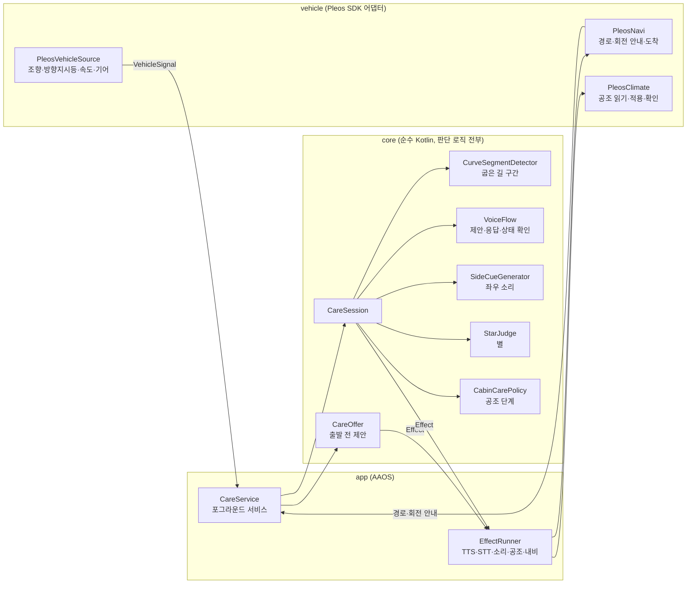

# 멀미케어 (Mulmi Care)

> 굽은 길을 가족 리듬 놀이로 바꾸고 실내 공기를 알아서 맞춰, 뒷자리 아이의 멀미 부담을 덜어 주는 차량 전용 동승자 케어 앱

Pleos Connect(Android Automotive OS)용 Kotlin 앱입니다. 차량의 조향·방향지시등·속도·공조와 내비게이션 정보를 읽어 **소리로** 바꿉니다. 주행 중에는 화면을 띄우지 않습니다.

> 본 앱은 의료 목적의 서비스가 아니며, 멀미를 덜 수 있는 환경을 만드는 것을 목표로 합니다.

---

## 제출 정보

### 1. 앱 이름 및 한 줄 소개
**멀미케어 (Mulmi Care)**: 굽은 길에서 차가 꺾이는 쪽을 소리로 먼저 알려 주고 실내 공기를 맞춰, 뒷자리 아이의 멀미 부담을 덜어 주는 차량용 동승자 케어 앱

### 2. 실행 방법
1. Pleos Connect 에뮬레이터를 켜고(Cold boot) APK를 설치합니다.
   ```bash
   adb install -r -g "apk/멀미케어_멀미케어_release.apk"
   ```
   `-g` 없이 설치했다면 처음 실행할 때 나오는 차량 속도 권한을 허용합니다.
2. 앱 목록에서 **멀미케어**를 실행합니다. 앱은 백그라운드 서비스로 계속 동작하며, 홈 화면의 **케어 시작**으로 바로 켤 수도 있습니다.
3. 기어가 P인 상태에서 Pleos 내비에 30분 넘게 걸리는 목적지(예: 오색약수)로 안내를 시작하면, 앱이 "케어를 켤까요?"라고 묻고 설정 카드를 띄웁니다. 마이크로 **"응"**이라고 하거나 **케어 시작**을 누릅니다. 처음 한 번은 30초 연습 화면이 나옵니다.
4. Virtual Console에서 기어를 D로 바꾸고 속도를 올린 뒤 핸들을 좌우로 여러 번 돌리면(1분 안에 3번 이상), 굽은 길로 판단해 "리듬 놀이 할까요?"라고 묻습니다. "응"이라고 하면 비트가 시작되고, 핸들을 꺾는 쪽에서 소리가 납니다.
5. 기어를 P로 바꾸면 항해 지도가 나옵니다. 목적지에 도착하면 케어가 끝나 리포트가 나오고 공조가 케어 전 상태로 돌아갑니다. 에뮬레이터 내비는 현재 위치가 고정이라 도착이 일어나지 않으므로, 디버그 빌드에서 `adb shell am broadcast -a com.mulmicare.DEBUG_END_CARE`로 도착을 흉내 냅니다.

실제 한계령 도로로 주행을 재현하는 시연 스크립트(`scripts/emulator/demo.sh`)는 adb로 음성 응답을 흉내 내므로 **디버그 빌드**에서 동작합니다. 빌드 방법은 [실행](#실행)을 참고하세요.

### 3. 테스트 환경 및 필요한 설정
| 항목 | 내용 |
|---|---|
| 에뮬레이터 | Pleos Connect Emulator v2.1.0 (Android 14, API 34, x86_64) |
| 차량 신호 | Virtual Console(에뮬레이터 Extended Controls 또는 `adb forward tcp:8088 tcp:8088` 후 HTTP)로 기어·속도·조향·방향지시등 조작 |
| 공조 | Virtual Console에서 **공조 전원을 켠 상태**여야 앱의 공조 설정이 반영됩니다 |
| 음성 | TTS·STT 모두 Pleos ON_DEVICE 모드(네트워크 불필요). 음성으로 답하려면 Extended Controls → Microphone에서 "Virtual microphone uses host audio input"을 켭니다 |
| 권한 | 차량 신호(조향, 방향지시등, 속도, 기어), 공조 조회·제어, 외기 온도, 내비 경로·경유지, TTS·STT, 포그라운드 서비스. 목록: [AndroidManifest.xml](app/src/main/AndroidManifest.xml) |
| 빌드 | Android Studio 내장 JDK, Gradle 9.4.1, Android Gradle Plugin 9.2.0, Kotlin 2.4.0, compile·target SDK 34 |

### 4. 개발에 사용한 에뮬레이터 버전과 화면 규격
- **Pleos Connect Emulator v2.1.0** (AVD `Pleos_Connect_v2.1.0`, system image `android-34/pleos_car_emulator/x86_64`)
- 화면 **2560 × 1440 px, 160 dpi**(mdpi), 가로. 앱 화면은 오른쪽 메인 영역에 표시됩니다.

### 5. APK 파일 위치
- 릴리스 APK: [`apk/멀미케어_멀미케어_release.apk`](apk/멀미케어_멀미케어_release.apk) (버전 1.0.0, 릴리스 서명)
- 시연 영상: [`docs/demo/mulmi-care-demo.mp4`](docs/demo/mulmi-care-demo.mp4) (2분 47초)

---

## 왜 만들었나

운전자는 차가 언제 돌고 멈출지 미리 알고 몸을 기울이기 때문에 멀미를 잘 하지 않습니다. 뒷자리 아이는 다음 움직임을 모른 채 흔들립니다. 실차 연구들에서 다가오는 움직임을 미리 알려 주거나, 도는 쪽으로 머리를 기울이거나, 앞을 볼 때 멀미가 덜한 것으로 보고되었습니다[1–3]. 다만 소수의 성인을 대상으로 한 연구여서 아이에게 그대로 적용된다고 단정할 수는 없습니다.

그래서 멀미케어는 **"차의 움직임을 알고, 앞을 보며, 도는 쪽으로 몸을 기울이는" 동작을 놀이로 만들고**, 일반적으로 권장되는 **신선하고 시원한 공기, 적절한 휴식**을 함께 묶었습니다. 운전자가 이미 아는 정보를 운전자에게 되풀이하지 않고, 그 정보가 필요한 뒷자리 아이에게 리듬으로 전합니다.

## 한 번의 이동

```
출발 전   내비에 2시간 거리 목적지 → 🗣 "케어를 켤까요?" → "응" → 케어 시작, 공조 기본 단계(외기, -1℃)
고속도로  아무 말도 하지 않음
굽은 길   🔔 "리듬 놀이 할까요?" → "응" → 🎵 비트 시작 / 공조 강화 단계(더 낮추고 풍량↑, 상체 방향)
          핸들이 오른쪽으로 → 🔊 오른쪽 소리   방향지시등 왼쪽 → 🔊 차가 돌기 전에 왼쪽 소리
          급감속 → ✨ 별 하나 떨어짐(효과음만)
구간 끝   🗣 "종이배 도착! 별 두 개를 지켰어요" → 🎵 끝 → 🗣 "뒷자리는 괜찮아요?"
힘들 때   "힘들어해요" → 공조 강화 + 🗣 "18km 앞에 쉼터가 있어요. 들를까요?"
도착      케어 끝 → 공조를 케어 전 상태로 되돌림
```
놀이는 **"응"이라고 답할 때만** 시작합니다. 거절하거나 답이 없으면 15분 동안 다시 묻지 않고, 놀이 중 "그만"이라고 하면 바로 끝납니다.

## 구현 상태 (1차)

기획서 기능 번호 기준입니다. 상세 규칙과 ID는 [docs/spec.md](docs/spec.md)에 있습니다.

| 기능 | 상태 | 내용 |
|---|---|---|
| ① 출발 전 설정 (F1) | ✅ | 내비 경로 30분 이상 + P단이면 음성 제안과 함께 설정 카드(탑승자·놀이 제안 여부·종이배·음악 테마)를 띄움. "응"이나 버튼으로 시작 |
| ② 30초 연습 (F2) | ✅ | 처음 쓸 때, 정차 중, 아이가 탈 때만 연습 화면. 소리가 나면 종이배가 같은 쪽으로 기울어짐. 건너뛰기 가능. 놀이 처음 3번은 "왼쪽!"·"오른쪽!"도 말로 알림 |
| ③ 놀이 제안 (F3) | ✅ | 굽은 길 구간에서만 한 번 묻기, "응"일 때만 시작, 거절·무응답 15분 쿨다운, "그만", 묻는 때와 놀이 중에만 듣기 |
| ④ 주행이 악보가 되는 리듬 (F4) | 🟡 부분 | 조향 시작 순간 좌우 소리, 방향지시등 점등 시 미리 좌우 소리, 앱이 만든 비트. **회전이 이어지면 악기가 더해지는 레이어(F4.4)는 아직 없음** |
| ⑤ 별 지키기 (F5) | ✅ | 별 3개, 급조향·급감속마다 1개(최소 1개), 효과음만, 판 끝 멘트. 별 5개마다 종이배 꾸미기(돛·깃발 등)가 하나씩 열림(F5.8) |
| ⑥ 실내 자동 케어 (F6) | ✅ | 기본·강화 단계, 5분 뒤 복귀, 겨울 보정, 반영 확인. **추가: 케어가 끝나면 원래 공조로 되돌림** |
| ⑦ 상태 확인·쉬어 가기 (F7) | ✅ | 구간 끝 "뒷자리는 괜찮아요?", 힘들어하면 강화 + 내비 경로 위 휴게소·졸음쉼터 안내 |
| ⑧ 정차 중 화면 (F8) | ✅ | P단에서만 항해 지도(판마다 별, 다음 굽은 길, 종이배 꾸미기). 기어가 P를 벗어나면 화면을 내리고 Pleos 내비를 앞으로 올림 |
| ⑨ 도착 후 리포트 (F9) | ✅ | 판별 흔들림 물결과 별, 뒷자리 평가(괜찮았어요/힘들어했어요). 기록은 차 안에만 저장하고 홈에서 지울 수 있음. 힘들었으면 다음 이동은 강화 단계로 시작 |

### 기획서와 달라진 점
| 항목 | 기획서 | 실제 | 이유 |
|---|---|---|---|
| 쉼터 찾기 | 공개 위치 데이터를 앱에 포함 | **내비 회전 안내의 휴게소·졸음쉼터 항목**으로 찾음 | 경로 위 쉼터만 정확히 찾고 위치를 외부로 보내지 않음. 회전 안내에는 좌표가 없어 경유지 대신 "가는 길에 있어요. 입구가 나오면 들어가세요"라고 안내 |
| 공조 | 케어 중 조절 | 케어가 끝나면 **원래 상태로 되돌림** | 되돌리지 않으면 이동할 때마다 온도가 계속 내려감 |
| 조향 기준값 | 핸들 각도 | **앞바퀴 각도** | Pleos SDK가 앞바퀴 조향각을 줌 |

## 구조


- **core는 입력(차량 신호·음성 응답·시간)을 받아 할 일 목록(Effect)만 돌려줍니다.** Android·Pleos에 의존하지 않아 모든 판단 로직을 JVM 테스트로 검증합니다.
- **vehicle**은 Pleos SDK 값을 core 타입으로 바꾸고 요청을 전달만 합니다.
- **app**은 Effect를 실제 소리·음성·공조·내비 요청으로 실행합니다.

사용한 Pleos SDK: Vehicle 2.3.2(조향·방향지시등·공조), NaviHelper 3.0.5, TextToSpeech 3.3.1, SpeechToText 3.3.1(둘 다 ON_DEVICE, ko-KR). 차량 속도·기어·바깥 기온은 Android Car API로 읽습니다.

## 안전·개인정보 원칙

| | 원칙 | 구현 |
|---|---|---|
| S1 | 주행 중 화면 표시 없음 | 주행 중 안내는 모두 소리. 설정·연습·항해 지도·리포트 화면은 P단에서만 보이고, 기어가 P를 벗어나면 내비 화면으로 비켜 줌 |
| S2 | 놀이 자동 시작 없음 | "응" 없이 비트가 시작되는 경로가 없음을 테스트로 고정 |
| S3·S5 | 운전 중 조작 요구·운전 지적 없음 | 별이 떨어져도 효과음만, 주행을 평가하는 멘트 없음 |
| S4 | 위험한 제어 없음 | 공조 외 차량 제어(창문 등) 없음 |
| S6 | 내비 안내 우선 | 앱 멘트는 대기열로 순서대로, 질문을 다 말한 뒤에 마이크를 엶. *내비 음성과의 오디오 포커스 처리는 실차 확인 필요* |
| S7·S8 | 아이 개인정보 미수집, 외부 전송 없음 | 이름·나이를 받지 않음. TTS·STT는 ON_DEVICE, 쉼터는 내비 정보로 찾음. 공조 기준값만 기기 안에 저장. (TTS·STT SDK가 `INTERNET` 권한을 매니페스트에 합쳐 넣지만 앱은 쓰지 않음) |
| S10 | 승인된 최소 권한 | 선언 권한과 이유: [permissions.md](.claude/skills/pleos-sdk/references/permissions.md) |

## 검증

### 테스트 (TDD)
판단 로직은 테스트를 먼저 쓰고 구현했습니다. 경계값(기준 바로 아래·같음·바로 위)과 "하지 않는다"는 안전 규칙도 테스트로 고정했습니다.
- core 170개: 굽은 길 구간, 좌우 소리, 별, 음성 흐름, 공조, 출발 전 제안, 쉼터 찾기, 기획서 시나리오(SC3 굽은 국도, SC4 운전 집중) 인수 테스트
- vehicle 20개: SDK 값 변환(조향 보정, 기어, 속도 단위, 풍향, 회전 안내)

### 에뮬레이터 (Pleos Connect Emulator v2.1.0)
| 확인 항목 (기획서 "구현 착수 전 검증 항목") | 결과 |
|---|---|
| 1. 조향·방향지시등·속도·기어 조회, 공조 제어 | ✅ 수신·제어·반영 확인 |
| 2. 내비 예상 소요 시간·회전 안내 | ✅ 경로 시작 시 소요 시간, 경로 전체 회전 안내(휴게소 포함) 수신 |
| 3. 앱이 화면에 없을 때 수신·음성 출력·음성 응답 인식 | ✅ 포그라운드 서비스, 한국어 TTS, 사람 목소리 "응"·"그만" 인식 |
| 4. 내비 안내 음성과 겹칠 때 | ⬜ 미확인 |
| 5. 외기 유입과 자동 내기 전환 충돌 | ⬜ 미확인 |

기획서 SC3(굽은 국도) 흐름을 Virtual Console로 재생해 처음부터 끝까지 확인했습니다. 상세 기록: [docs/emulator-checklist.md](docs/emulator-checklist.md)

### 한계 (실차에서 확인할 것)
- 에뮬레이터는 조향 값을 SDK 문서(앞바퀴 각도)와 다르게 **핸들 각도·반대 부호**로 줍니다. 앱은 에뮬레이터를 감지해 보정하며, 실차는 문서대로라고 가정했습니다.
- 굽은 길 판단·좌우 소리·별 판정의 기준값(조향 1°, 급조향 15°/s, 급감속 8km/h/s 등)은 **임시값**입니다. 시험 주행으로 보정해야 합니다. ([Thresholds.kt](core/src/main/kotlin/com/mulmicare/core/config/Thresholds.kt))
- 내비는 경로 모양을 주지 않아, 굽은 길에 **들어선 뒤**(최근 1분 조향·감속 3회) 판단합니다. 경로로 굽은 길을 미리 아는 것은 2단계 과제입니다.
- 실제 차량 스피커에서 뒷자리가 좌우 소리를 구분할 수 있는지, 실제 멀미 완화 효과는 확인하지 못했습니다.

## 실행

### 준비
- Android Studio(내장 JDK 사용), Android SDK 34
- Pleos Connect Emulator v2.1.0 (Cold boot), 공조 시험은 Virtual Console에서 공조 전원을 켠 상태
- Pleos Maven 저장소는 [settings.gradle.kts](settings.gradle.kts)에 등록되어 있음

### 빌드·테스트
```bash
export JAVA_HOME="<Android Studio>/jbr"
./gradlew :core:test                       # core 판단 로직
./gradlew :vehicle:testDebugUnitTest       # SDK 값 변환
./gradlew :app:assembleDebug               # 디버그 APK (시연 스크립트용)
./gradlew :app:assembleRelease             # 릴리스 APK (keystore.properties로 서명, 없으면 서명 없이)
adb install -r -g app/build/outputs/apk/debug/app-debug.apk
```

### 에뮬레이터 시나리오
```bash
adb forward tcp:8088 tcp:8088                                              # Virtual Console
adb shell am start -n com.mulmicare.app/.MainActivity --ez autostart true  # 디버그: 바로 케어 시작
bash scripts/emulator/sc3-country-road.sh                                  # SC3 굽은 국도 재생 (약 3분)
bash scripts/emulator/enter-curve.sh 60                                    # 굽은 길 진입 후 마이크로 직접 "응"
bash scripts/emulator/demo.sh                                              # 시연: 실제 한계령 도로로 주행 재현 (약 9분)
adb logcat -s MulmiCare                                                    # 동작 로그
```
디버그 빌드에서는 adb 브로드캐스트로 음성 응답(`com.mulmicare.DEBUG_SAY --es text 응`), 내비 경로 요청(`DEBUG_ROUTE`), "힘들어해요" 버튼(`DEBUG_STRUGGLE`), 케어 시작·끝(`DEBUG_START_CARE`, `DEBUG_END_CARE`)을 흉내 낼 수 있습니다.

## 개발 방식

[Claude Code](https://claude.com/claude-code)와 함께 개발했습니다. 저장소의 [`.claude/`](.claude/)에 이 프로젝트용 작업 규칙(하네스)이 있습니다. 기획서 규칙 추적, TDD 절차, Pleos SDK 사용법·검증 기록, 안전 원칙 점검, core 수정 시 테스트 자동 실행이 들어 있습니다.

## 시연
실제 한계령(44번 국도) 도로 좌표로 주행을 재현해 시연합니다: 곧은 길에서는 조용하다가 고갯길에 들어서면 놀이를 제안하고, 커브 방향대로 좌우 소리를 냅니다. 에뮬레이터 내비는 위치를 바꿀 수 없어 같은 주행을 별도의 재현 지도에 보여 줍니다. 시나리오: [docs/demo-video.md](docs/demo-video.md)

경로 좌표: © OpenStreetMap contributors (ODbL), OSRM으로 계산. 재현 지도 배경: © OpenStreetMap contributors.

## 참고 연구
1. Reuten, Yunus, Bos, Martens, Smeets, "Anticipatory cues can mitigate car sickness on the road", *Transportation Research Part F*, 105, 2024.
2. Wada, Konno, Fujisawa, Doi, "Can Passenger's Active Head Tilt Decrease the Severity of Carsickness?", *Human Factors*, 2012.
3. Wada, Yoshida, "Effect of passengers' active head tilt and opening/closure of eyes on motion sickness in lateral acceleration environment of cars", *Ergonomics*, 59(8), 1050–1059, 2016.
